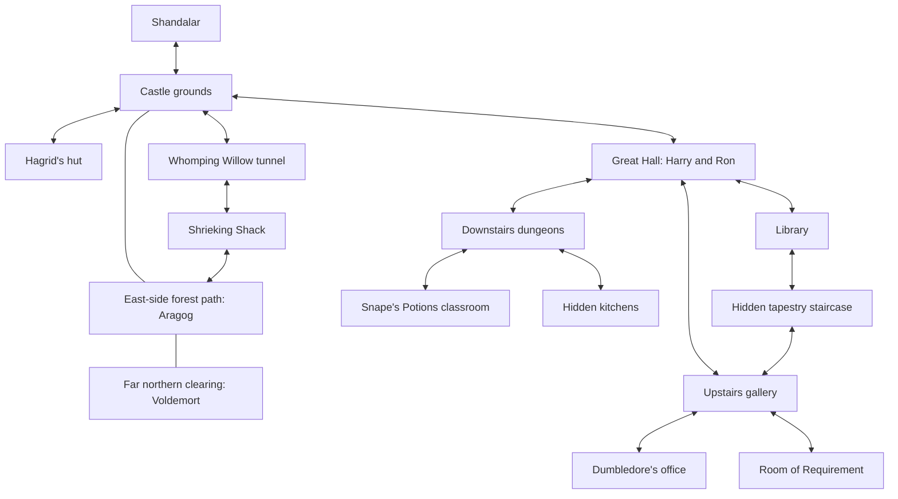

# Hogwarts estate expansion

The Hogwarts point of interest keeps its existing identity and overworld placement. The legacy entrance filename `hogwarts_great_hall.tmx` now contains the castle grounds, while `hogwarts_hall.tmx` contains the interior Great Hall. Keeping the entrance filename unchanged preserves Forge's map-based saved POI ID; no save edit or overworld regeneration is needed to use the expanded location after updating the game and satisfying the content pack dependencies. The displayed room names describe the current contents.

The estate has eleven maps, replacing the old two-room hub:

| Map | Size in tiles | Contents |
| --- | --- | --- |
| Castle grounds and Forbidden Forest | 112 × 120 | Castle exterior, front-left hut, east-side forest path, Aragog, Voldemort, boar, wolf, giant spider, centaur, four caches |
| Great Hall | 56 × 44 | Harry and Ron, library doorway, up/down stairs, one cache |
| Library | 36 × 36 | Bookcases, reading desks, Preordain cache |
| Upper galleries | 48 × 40 | Headmaster's office entrance, reading alcoves, shard cache |
| Dumbledore's office | 40 × 36 | Dumbledore, books, desk, phoenix perch, basin, gold cache |
| Dungeons | 56 × 40 | Stairs to Great Hall, ingredient storage, gold cache, Potions doorway |
| Potions classroom | 40 × 36 | Snape, brewing stations, ingredient shelves, HP Polyjuice Potion cache |
| Hagrid's hut | 28 × 24 | Hagrid, hearth, table, creature-care supplies, shard cache |
| Hidden kitchens | 36 × 28 | Pear-painting entrance, cooking stations, provision tables, gold cache |
| Room of Requirement | 36 × 30 | Hidden gallery entrance, shelter and practice notes, shard cache |
| Shrieking Shack | 32 × 28 | Willow tunnel, displacement-created forest exit, gold cache |

The forest and its two clearings are continuous parts of the grounds map. No magical portal or Shadow Chamber remains in the map graph. The south gate is the only overworld exit. Arrival positions are placed clear of the doorway trigger and facing into the destination's accessible space.

## Encounters and rewards

The seven main location opponents offer Begin duel and Perhaps later. Four additional forest encounters reuse Forge's existing creatures, decks, and sprites: a boar (13 life), wolf (20), giant spider (15), and centaur (16). The three wild beasts start combat on contact; the centaur offers an optional friendly challenge. They occupy side paths rather than the main route. Each gives 80–119 gold and 3–5 shards on Normal. The native wolf's existing 87-card deck is retained; the other three native decks have 60 cards. Native global encounters and decks are unchanged.

The five established roaming enemies retain their unlocks and region rules; the eleven location encounters are stationary. All sixteen pack enemy definitions give two random cards from their own deck on Normal before player equipment bonuses. Gold and shards for the original opponents are unchanged. Aragog has 26 base life; Snape has 22; each has 300–499 base Normal gold and 10–14 shards.

Aragog's deck contains twelve distinct Spider creature designs: Aragog, Acromantula Brood, Deadly Recluse, Chainweb Aracnir, Nyx Weaver, Rotwidow Pack, Ishkanah, Silklash Spider, Hatchery Spider, Skyfisher Spider, Twin-Silk Spider, and Sporecap Spider. Grisly Salvage and Spider Spawning support the graveyard and token plan. There are 26 Spider creature cards, nine support spells, and 25 lands.

Snape's deck has twelve creatures, 24 other spells/artifacts, and 24 lands. Its main colors support Snape's white-blue-black cost, scry/surveil, and Clue creation. The small red splash casts his Sectumsempra; fetchlands and dual lands support all four colors. Witching Well, Witch's Cauldron, Polyjuice Potion, Elixir of Immortality, and the Pensieve supply the Potions/Occlumency theme without requiring new custom card designs.

Fourteen exploration caches use Forge's normal reward actors and persistent object IDs. The two card pickups are one Preordain in the library and one HP Polyjuice Potion in the classroom stores. Other caches provide 70–159 gold or 3–9 shards, depending on their individual base and random addition. They do not grant an entire enemy deck, and enemy victory rewards still draw randomly rather than guaranteeing a mythic.

## Discoveries and atmosphere

Feast tables now carry tableware, books and house-colour details, with more candles nearby. The gallery has framed decorations and rugs; the library and office have reading materials and instruments; Potions has additional bottles and brewing notes. Trees, pumpkins, plants, roots and fallen branches break up the grounds and forest. Interactive details explain the unfamiliar sky, the Pensieve, and the displaced castle without introducing implementation terminology into the game.

Secrets use existing dialogue actions and a small optional entry gate: `requiredQuestFlag` names a persistent discovery flag, and `lockedText` explains a closed entrance. Ordinary entries retain their existing behavior. All discoveries are optional and remain unlocked for that player after saving.

- Tickle the pear in the fruit painting near the dungeon stairs to open the kitchens below the Great Hall. The entrance is based on the [official kitchens description](https://www.harrypotter.com/fact-file/locations/hogwarts-kitchens).
- Pass the blank wall opposite Barnabas the Barmy's tapestry three times, concentrating on shelter, to discover the Room of Requirement. The three passes are represented by successive dialogue choices. The source is the [official Room of Requirement description](https://www.harrypotter.com/fact-file/locations/the-room-of-requirement).
- Lift a loose tapestry in the library or gallery to open a narrow staircase connecting them. Tapestry-hidden passages are canonical; these particular endpoints are an adaptation for this compact map, inspired by [Hogwarts' secret spaces](https://www.harrypotter.com/features/the-camouflaged-corners-and-secret-spaces-of-hogwarts).
- Use a fallen stick to press the Whomping Willow's knot and enter its tunnel to the Shrieking Shack. The [Willow's tunnel and purpose](https://www.harrypotter.com/fact-file/plants-and-potions/the-whomping-willow) and [knot mechanism](https://www.harrypotter.com/features/web-hidden-entrances-wizarding-world) come from the story. A newly broken wall in the displaced shack opens onto our northern forest, providing a second shortcut. That exit is explicitly part of this Adventure adaptation, rather than a claim about the original castle layout.

## A Castle Out of Place

This one-time quest joins the ordinary Shandalar town quest-giver pool while an active, dependency-enabled Hogwarts exists in the current world. It is not forced on new games or offered in a world without the castle. A townsfolk rumour explains that a magical castle has arrived from another plane.

1. Travel to Hogwarts in the colorless region. Arrival dialogue directs the player through the Great Hall's rear-right stairs to Dumbledore's upstairs office.
2. Speak to Dumbledore, who asks the player to defeat Voldemort at the northern end of the forest.
3. Defeat that named encounter to complete the quest immediately, with no return to Dumbledore or the town. Its one-time reward is 500 gold, 10 shards, and three random HP cards, including eligible mythics. A completion claim dialogue follows normal battle loot so both rewards are preserved. His practice duel remains optional and separate from the story.

Dumbledore and the named victory stage check both the root location's recorded enemy defeat and saved lifetime wins under the enemy's ID/display name. Thus an earlier castle victory, including an older save that only recorded a win against `Voldemort`, qualifies immediately after the player reaches Hogwarts and speaks to Dumbledore. A loss does not qualify, and another Hogwarts opponent does not satisfy the named target. An earlier battle win is distinct from completing this quest: a character with a saved `questCompleted:90701` flag cannot be offered or accept the quest again. Active duplicates are also blocked. An abandoned, unfinished quest may be offered again; prior battle wins still count. Normal encounter rewards remain unchanged.

Town offers are uniformly selected from currently eligible templates; this quest has no special rarity weight. Before world/progress filters, the tag-compatible pools including this quest are:

| Town region | Candidate templates | Chance per eligible new offer if all candidates are available |
| --- | ---: | ---: |
| Forest, mountain, or plains | 10 | 10% |
| Island | 12 | 8.3% |
| Swamp | 11 | 9.1% |
| Wastes/colorless | 17 | 5.9% |

These counts apply equally to generic, identity, and tribal town givers. Actual eligibility can remove competing quests, increasing its share. Normal giver cooldowns, an existing quest from that town, and the five-active-side-quest limit can prevent a new roll entirely. Hogwarts must exist and be enabled, and this quest must be neither active nor previously completed for that character/save.

The optional-content loader now merges `questDefinitions` atomically with the other enabled group resources and rejects duplicate, missing, or nonpositive explicit quest IDs. `AdventureQuestData.requiredPOI` limits offers to worlds containing the available location. The reusable dialogue condition `defeatedEnemy` recognizes previous victories; it does not mutate their history. Defeat stages can name an existing `targetEnemy` and opt into `creditPreviousVictory`. Named existing encounters do not create or boost overworld quest spawns; ordinary tag-selected quests are unchanged.

## Assets and compatibility

Hogwarts uses a dedicated simplified 32×32 castle icon on the minimap, matching the native castle/capital marker size. Its detailed overworld sprite stays separate. `PointOfInterestData.minimapIconSize` opts a location into this display override; zero retains the ordinary marker. The optional `minimapIcon` names a dedicated PNG; omitting it uses the overworld sprite. Both the HUD minimap and full map use the same cached display image. Existing saves have the old marker's terrain restored beneath the castle, with overlapping neighboring markers preserved. The original saved minimap image and POI type/identity are unchanged; loading or generating a world clears the display cache.

Harry now uses a custom generated animation sheet in both the castle and roaming encounters, with round glasses throughout the animation states. His 256×256 frame boxes use scale 0.0859375, matching Ron at 22×22 map units. The original generated PNG and alpha are retained. Harry, Dumbledore, Ron, Hagrid, and Voldemort use Forge's standard horizontal mirroring for left-facing animations; wand/umbrella hand changes are accepted. Snape retains his separate directional poses.

The castle facade and hut are original generated pixel-art assets with transparent backgrounds. Native scaled decorative tile actors place them without changing their image files or engine rendering code. Interior furniture, flooring, stairs, forest tiles, spider webs, and reward animations use existing Forge assets. The forest encounter uses the existing animated black spider. Snape uses a generated portrait for dialogue and duels and a custom animated sheet derived from a native wizard. After image-tool correction attempts failed, the user authorized local pixel editing for Snape only: incorrect wand poses were corrected to use his right hand while preserving the remaining artwork. His atlas supplies explicit left- and right-facing idle, walk, attack, hit, and defeat animations so Forge's automatic mirroring cannot switch the wand hand. Uniform 192×224 frame boxes at scale 0.125 give him a 24×28 world footprint and consistent foot alignment. The portrait remains unchanged. The shared right-facing idle/walk frames retain thin wand shafts with brighter wood pixels. Direct renders at the saved 2560×1440 resolution and default zoom verify visibility in every walk frame; preview artwork is not first reduced to one pixel per map unit.

The Hogwarts dependency group now validates seven HP decks and four reused native creature decks, all eleven maps, the new exterior tileset/images, Snape's portrait/atlas/body pages, native sprite dependencies, and the existing custom card/token requirements. A missing new dependency disables the complete Hogwarts group, including its town quest. Human Elite, Esper, and Cook variants remain separate groups.

Validation covers native TMX loading and rendering, reciprocal entry links, collision-aware routes from every arrival to doors/opponents/caches, native dialogue/reward parsing, complete deck loading, real reward generation, missing-dependency behavior, copied-save identity/state preservation, and new-world generation. Generic optional-content tests remain applicable. These are offline checks against source resources; no installed game, player inventory, or save is deployed or rewritten. Manual play after the user installs an Integration build remains a useful final feel/visual check.

The implementation review includes the full Maven `-U -B clean test` reactor, generic optional-quest/history/gating regression tests, native loading of all eleven maps and eleven opponents, reward generation for all sixteen encounter definitions and fourteen caches, and enabled/disabled new-world checks. Copied-save checks preserve all 748 locations and Hogwarts' coordinates; source save bytes remain unchanged. Native story checks cover new and prior victories, losses, mid-quest serialization, and one-time completion. A distributable was not built. The existing installer resource inclusion covers the new assets under `forge-gui/res`.

Delivery follows the normal Integration workflow. Do not directly install these source assets or replace game binaries without explicit permission.
